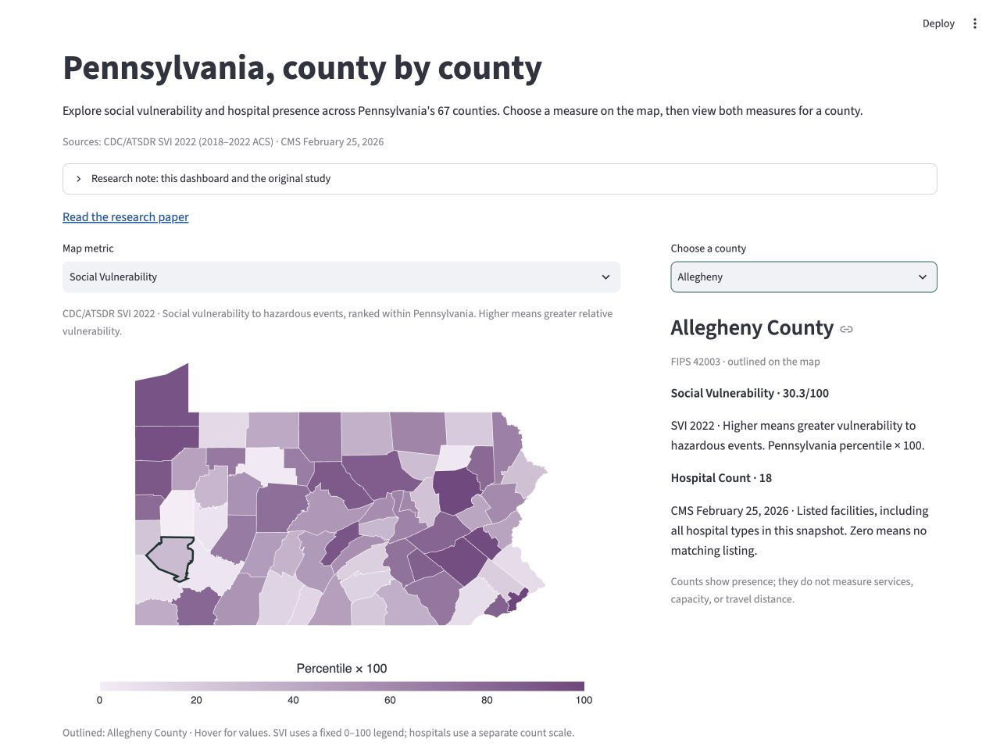

# Pennsylvania, county by county

**[Open the live dashboard](https://pa-health-equity.onrender.com/)**

Explore **Pennsylvania-relative social vulnerability** and **hospital presence** across 67 counties. This dashboard explores two measures from the broader health-equity study. It does not reproduce the paper's Priority Opportunity Score (POS) findings or create a combined score or priority ranking.

> CDC/ATSDR source data is freely available from the [agency website](https://svi.cdc.gov/). This independently developed project is not endorsed by CDC, ATSDR, HHS, or the U.S. Government.



[Research paper](https://suseelkrishna.onrender.com/static/reports/pennsylvania-health-equity-masters-paper.fdd9caa6e888.pdf) · [Portfolio](https://suseelkrishna.onrender.com/). The paper destination matches the [portfolio project page](https://suseelkrishna.onrender.com/work/pennsylvania-health-equity-dashboard/) (verified October 17, 2026). No software license has been assigned.

## Setup and verification

Use Python **3.12.14**. From the project directory:

```sh
python3.12 -m venv .venv
.venv/bin/python -m pip install -r requirements.lock
PYTHONPATH=src .venv/bin/python -m unittest discover -s tests -v
PYTHONPATH=src .venv/bin/python -m streamlit run app.py --server.address 127.0.0.1 --server.port 8501
```

Open `http://127.0.0.1:8501`. The app loads the six-file `data/releases/v0.2.0-rc1/` bundle and verifies its checksums, source/method metadata, 67 unique county identifiers, source ranges, facility audit, and matching longitude/latitude polygons. It does not ingest or rebuild raw data.

## Sources and interpretation

- **CDC/ATSDR SVI 2022:** official Pennsylvania-relative county `RPL_THEMES`, based on 2018–2022 ACS estimates. The displayed score is exactly `100 × RPL_THEMES`. Higher means greater vulnerability to hazardous events relative to other Pennsylvania counties. The map scale is fixed at 0–100. [Data](https://svi.cdc.gov/Documents/Data/2022/csv/states_counties/Pennsylvania_county.csv) · [Definitions](https://www.atsdr.cdc.gov/place-health/media/pdfs/2024/10/SVI2022Documentation.pdf).
- **CMS Hospital General Information, February 25, 2026:** 188 unique PA facilities across 58 counties; nine counties have no matching listing. Includes 133 acute care, 26 psychiatric, 17 critical access, seven VA acute care, and five children's facilities. County labels were normalized and all records matched. Counts describe presence, not services, beds, adequacy, or travel distance. [Snapshot archives](https://data.cms.gov/provider-data/archived-data/hospitals).
- **U.S. Census Bureau TIGER/Line 2025:** all 67 PA counties, converted to EPSG:4326 and simplified for display. Statistical boundaries are not legal land descriptions. [Source](https://www2.census.gov/geo/tiger/TIGER2025/COUNTY/).

CDC/ATSDR source data is freely available from the [agency website](https://svi.cdc.gov/). This independently developed project is not endorsed by CDC, ATSDR, HHS, or the U.S. Government. Source attribution does not imply endorsement by CMS or the Census Bureau. [CDC reuse guidance](https://www.cdc.gov/other/agencymaterials.html) · [CMS data guidance](https://data.cms.gov/provider-data/topics/hospitals/about-data).

County summaries can hide differences within counties, and source years differ. Hospital counts and SVI remain separate. Historical paper findings have not been independently reproduced. Table scores show one decimal; CSV downloads preserve source values and full precision.

## Release notes — v0.2.0-rc1

The public bundle has exactly five CSV fields: `county_fips`, `county_name`, `svi_rpl_themes`, `svi_score_0_100`, and `hospital_count`, plus source and method metadata and the 67-county map. No raw datasets or local caches are included.
